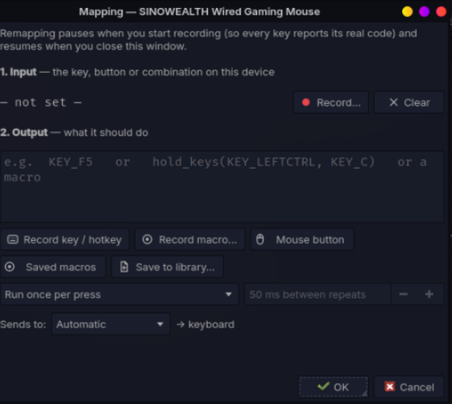
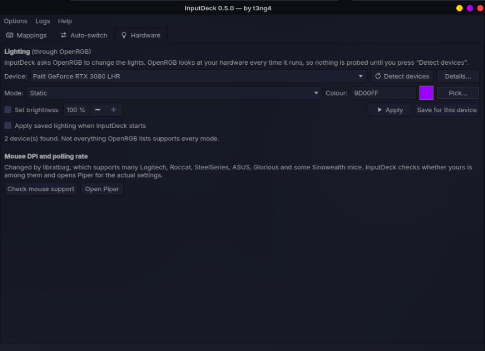

# Using InputDeck

## The window

* **Options** menu: macro library, import of rules from Saito's `config.txt`, repair of stale device IDs,
  setup check, *Reset to defaults*, *Remapping engine*, quit.
* **Logs** menu: live engine log, auto-switch & app log, open the log folder.
* **Help** menu: GitHub page, report a problem, About.
* **Mappings** tab: devices on the left, the selected preset's mappings on the right. A green dot marks the
  preset that is running; the banner above says it in words.
* **Auto-switch** tab: rules, check interval, tray option, the window-state switch, and the live switching log.
  Rules are stored in `~/.config/inputdeck/rules.txt`.

## Remap a button

1. Select the device, then **Add mapping…**.
2. **Record…** and press the button or key combination on that device.
3. Choose the output:
   * **Record key / hotkey**: press the key (or combination) you want it to produce.
   * **Mouse button ▾**: a mouse button.
   * **Record macro…**: see below.
   * or type it: `KEY_F5`, `hold_keys(KEY_LEFTCTRL, KEY_C)`, `disable`, or any supported macro.
4. Optionally set **Repeat while the key is held** or **Toggle** and a delay.
5. OK. With *Apply the preset right after saving* ticked, it is active immediately.

<p align="center"></p>

## Record a macro

**Record macro…** → pick the devices to listen to → **Start recording**, perform the sequence, **Stop
recording**. Quick taps become `key(X)`, held keys become `key_down`/`key_up`, and the pauses become
`wait(ms)`. Double-click a wait to retime it, select steps and press <kbd>Delete</kbd> to drop them, or tick
*fixed pause* to replace the natural timing. Mouse *movement* is not recorded, only button presses.

## Reuse macros: the library

* In the mapping dialog: **Save to library…** and the **Saved macros** menu.
* Right-click a mapping: **Assign a saved macro**, **Change input… (keep the output)**, **Save this output to the
  macro library…**. Right-click empty space: **Add mapping with a saved macro**.
* **Options → Macro library…** to rename, edit the steps or delete.

## Switch presets per program

On the **Auto-switch** tab: **Add rule…**, enter part of the program's command line (or **Pick running
program…**), choose device and preset. The first matching rule per device wins; tick *Fallback* for a rule that
applies when nothing else matches. Order matters: use **Move up / down**. A manual **Apply preset** stays until
the rules decide something different (a game starts or exits).

### Only while the window is on screen (minimized or tray-hidden programs)

By default a rule applies as long as the program is **running**, even if it sits minimized or hidden in the
system tray. Each rule has a **While** setting to change that:

| While | The rule applies when… |
|-------|------------------------|
| running | the program is running (the default, same as Saito's tool) |
| window visible | the program has a window on screen: not minimized, not hidden in the tray, on the current virtual desktop |
| window focused | the program's window is the one you are working in |

Example: a game that you minimize or send to the tray while you work.

```
BlackDesert64.exe | My Mouse | Game    | window visible
DEFAULT           | My Mouse | Desktop
```

While the game window is on screen the mouse uses *Game*; as soon as you minimize it or send it to the tray, it
goes back to *Desktop*, and returns to *Game* when you bring the window back. The program is matched against
the window's class, its title and its command line, so the same name that works for "running" works here.

The **Auto-switch** tab has a switch to turn window checks off (every rule then behaves like "running") and
shows whether window detection works on your system.

**What works where.** Window detection uses `xprop` (package `xorg-xprop` on Arch, `x11-utils` on
Debian/Ubuntu, `xorg-x11-utils` on Fedora). On an X11 session it sees every window. On Wayland (KDE Plasma's
default) it sees windows of X11 programs through XWayland, which includes Windows games run through Wine or
Proton. Native Wayland programs are invisible to other programs by design, so a "window visible" rule for such
a program can't match; use "running" for those. If detection is not available at all, InputDeck says so in the
log and treats the rule as "running" instead of silently doing nothing.

In `rules.txt` (`~/.config/inputdeck/rules.txt`) the setting is an optional fourth field: `process|device|preset|visible`. Files without it keep
working unchanged.

## Hardware: lighting, DPI and polling rate

The **Hardware** tab does not talk to your devices itself. It uses tools that already know them, and it does
nothing until you press a button (OpenRGB looks at all your hardware each time it runs).

<p align="center"></p>

**Lighting (OpenRGB).** Press *Detect devices*, pick a device, choose a mode and a colour (hex like `FF8800`,
or *Pick…*), optionally tick *Set brightness*, and press *Apply*. *Details…* shows OpenRGB's own device
listing, including the mode names your device offers; you can type any of them into the Mode box. *Save for
this device* remembers the setting, and *Apply saved lighting when InputDeck starts* restores it at login
(only while the InputDeck window or tray icon is running; the headless `--daemon` doesn't do this).
Lights that OpenRGB can't change, or modes a device doesn't have, show OpenRGB's error message.
Graphics cards often have no *Static* mode: type `Direct` into the Mode box instead. If a graphics card
is listed but its lights never change and there is no error, OpenRGB probably lacks I2C access; *Details…*
says so and [docs/INSTALL.md](INSTALL.md#optional-lighting-and-mouse-settings) has the three commands that fix it.

**Mouse DPI and polling rate.** These are changed by libratbag. *Check mouse support* tells you whether libratbag
knows your mouse; if it does, *Open Piper* opens the settings. Many mice are not supported: libratbag covers
mainly Logitech, Roccat, SteelSeries, ASUS, Glorious and some Sinowealth devices. Generic mice from other
makers usually are not, and then DPI and polling rate can only be changed with the maker's own (Windows)
software or the buttons on the mouse. InputDeck does not write to a mouse's firmware itself, because wrong
values can leave a device misconfigured.

Install the optional tools with [INSTALL](INSTALL.md#optional-lighting-and-mouse-settings).

## Presets

**New**, **Duplicate** and **Delete** (deleted presets go to `~/.local/share/inputdeck/deleted-presets`). Every
save first copies the previous file to `~/.local/share/inputdeck/backups`.

## When things go wrong

* Built-in engine: <kbd>Ctrl</kbd>+<kbd>Alt</kbd>+<kbd>Shift</kbd>+<kbd>Esc</kbd> stops it instantly.
* **Options → Reset to defaults** (or `inputdeck --reset`): stops all remapping and the built-in engine and resets
  InputDeck's own settings. Presets, rules, macros and backups are never touched.
* **Logs** menu for what happened; attach it to bug reports.
